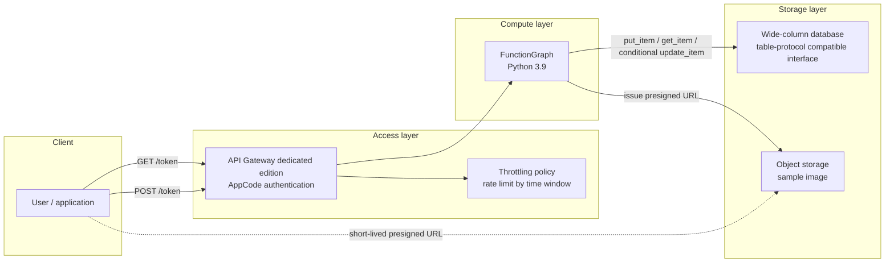

# internet-obs-single-use-token

> **Internet-facing single-use token exchange service for short-lived OBS presigned URLs**
[](LICENSE)
[](https://support.huaweicloud.com/intl/en-us/)
[](#)

---

## 1. Overview

This practice provides a **single-use token + short-lived presigned URL exchange** service for controlled access to objects in an object storage bucket. A client first calls `GET /token` to request a one-time token, then calls `POST /token` to exchange it for a short-lived (default 300 seconds) presigned URL. Each token can be consumed only once (replay protection), enforced atomically through a conditional write on the wide-column database. It is intended for DevOps, backend, and security operations engineers, and can be used as a reference architecture / learning sample / production template.

### Core capabilities

- **Single-use token generation**: `GET /token` generates a URL-safe random token and writes it into the wide-column database (with a wire-compatible table protocol interface)
- **Token exchange for a short-lived presigned URL**: `POST /token` atomically flips `valid: true` to `false` via a conditional write (replay protection), then issues a short-lived object-storage presigned URL
- **Rate limiting at the access layer**: a gateway throttling policy bounds the request volume per API per time window
- **Application authentication**: clients present a shared secret in the `X-Apig-AppCode` header, and the gateway enforces authentication
- **Private bucket + AES256 encryption**: bucket-level server-side encryption; the bucket stays private with no public policy attached, so objects are never anonymously readable
- **Optional Web Application Firewall**: the module ships with the repository and is disabled by default (see [Section 5](#5-cloud-services-used))

---

## 2. Table of Contents

- [1. Overview](#1-overview)
- [2. Table of Contents](#2-table-of-contents)
- [3. Architecture Diagram](#3-architecture-diagram)
- [4. Highlights](#4-highlights)
- [5. Cloud Services Used](#5-cloud-services-used)
- [6. Prerequisites](#6-prerequisites)
- [7. Quick Start](#7-quick-start)
- [8. Step-by-Step Deployment](#8-step-by-step-deployment)
- [9. Usage / Verification](#9-usage--verification)
- [10. Cleanup](#10-cleanup)
- [11. Detailed Explanation](#11-detailed-explanation)
- [12. Dependencies](#12-dependencies)
- [13. FAQ / Troubleshooting](#13-faq--troubleshooting)
- [14. Contributing](#14-contributing)
- [15. License](#15-license)
- [16. Contact / Maintainers](#16-contact--maintainers)

---

## 3. Architecture Diagram

> Two-step single-token + short-lived presigned URL flow: GET to request → POST to exchange for a URL → the client fetches the object directly with the URL.



**Key component notes**:

- **API Gateway (dedicated edition)**: API group + application authentication (AppCode) + two APIs (GET/POST `/token`) + throttling policy
- **FunctionGraph**: Python 3.9 runtime; `handler.py` implements GET/POST routing, the wide-column conditional write, and object-storage presigned URL issuance
- **Wide-column database (wire-compatible table protocol interface)**: cluster-mode instance; the token table is created automatically on first write (key `token`, with a TTL attribute)
- **Object storage**: private bucket (no public policy attached) + AES256 encryption + sample image
- **Web Application Firewall (optional)**: disabled by default; the module ships with the repository (see [Section 5](#5-cloud-services-used))

---

## 4. Highlights

- **Single-use token replay protection**: the conditional write `ConditionExpression="valid = :true"` atomically guarantees that a token is consumed only once; only one of concurrent requests succeeds
- **Simplified client**: application authentication (the `X-Apig-AppCode` header) replaces request-signature calculation, so the client needs no signing logic
- **Short-lived presigned URL**: 300-second validity by default, expiring automatically
- **Decoupled object-storage data plane**: the function only issues URLs; the actual object read is performed by the client connecting directly to object storage with the URL
- **Serverless compute**: the function is platform-managed and runs on event triggers
- **Modular Terraform**: five submodules are composed in dependency order, making secondary development and component replacement easy
- **Static IaC checks pass**: formatting, initialization, and configuration validation all report zero errors

---

## 5. Cloud Services Used

| Service | Purpose | Notes |
|---|---|---|
| API Gateway (APIG) | API group + application authentication + API publishing + throttling policy | Dedicated instance, basic edition |
| FunctionGraph | Handles GET/POST `/token` | Python 3.9 runtime; code package delivered through object storage |
| Object Storage Service (OBS) | Sample image + function code package + presigned URL target | Private bucket; AES256 encryption |
| GeminiDB cloud database | Token storage (key `token`, with a TTL attribute) | Wire-compatible table protocol interface; cluster mode |
| Web Application Firewall (WAF) | General web protection | **Module ships with the repository, disabled by default**; an optional service |
| Identity and Access Management (IAM) | Function execution agency (reading object storage objects) | Domain-level service role |
| Virtual Private Cloud (VPC) | Network integration for the wide-column instance, gateway, and function | 1 VPC + 1 subnet + 1 security group |

> **Where rate limiting lives**: the access-layer throttling policy handles rate limiting. If edge attack protection is a hard requirement, set `enable_waf` to `true`, but the WAF service must be activated first.

---

## 6. Prerequisites

| Item | Requirement | Notes |
|---|---|---|
| **Account** | Huawei Cloud account opened and real-name verification completed | Personal or enterprise account |
| **Permissions** | Account has IAM **Tenant Administrator** permission (or a permission combination covering the same resource-creation scope) | Used to create VPC / APIG / FunctionGraph / GeminiDB / OBS resources |
| **Region** | `cn-north-4` (Beijing 4) recommended | Terraform default |
| **Terraform** | `>= 1.5.0` | IaC deployment tool |
| **huaweicloud Provider** | `~> 1.95` | Huawei Cloud Terraform Provider |
| **PowerShell** | `>= 5.1` (Windows) | Package the function code + run deployment commands |
| **Access credentials** | Obtain access keys on the Huawei Cloud "My Credentials" page and provide them to Terraform as environment variables | **Do not** write credentials into any code or configuration files |

---

## 7. Quick Start

### One-click deployment (recommended)

```powershell
# 1. Enter the repository root
cd internet-obs-single-use-token

# 2. Configure Huawei Cloud access credentials (environment variables, see Section 6)
$env:HW_ACCESS_KEY = "<your-access-key>"
$env:HW_SECRET_KEY = "<your-secret-key>"

# 3. Package the function code (produces dist/token-handler.zip)
powershell -ExecutionPolicy Bypass -File scripts\package-function.ps1

# 4. Create terraform.tfvars and fill in the required items
Copy-Item infra\terraform.tfvars.example infra\terraform.tfvars
# Edit infra\terraform.tfvars: obs_bucket_name / code_bucket_name /
# geminidb_password / apig_appcode

# 5. Deploy (the code package is uploaded to object storage automatically, no manual upload needed)
cd infra
terraform init
terraform plan
terraform apply -auto-approve
```

> **Deployment duration**: roughly 10-15 minutes (wide-column instance initialization + function publishing + gateway instance startup).
> **Full steps and expected output for each**: see [Section 8](#8-step-by-step-deployment).

---

## 8. Step-by-Step Deployment

### Step 1: Initialize the working directory

```powershell
cd internet-obs-single-use-token/infra
terraform init
```

**Expected output**: `Terraform has been successfully initialized!`

### Step 2: Preview resource changes

```powershell
terraform plan
```

**Expected output**: `Plan: N to add, 0 to change, 0 to destroy.`

### Step 3: Apply the deployment

```powershell
terraform apply -auto-approve
```

**Expected output**: `Apply complete! Resources: N added, 0 changed, 0 destroyed.`

### Step 4: Record key outputs

```powershell
terraform output
terraform output -raw apig_appcode     # sensitive value, read separately
```

**Expected output**: lists key field values such as `api_base_url` / `token_endpoint` / `obs_bucket_name` / `geminidb_endpoint` / `function_urn`. Save them for subsequent verification.

---

## 9. Usage / Verification

> The commands below are for **post-deployment** self-verification of business functionality; run them in order. Static IaC checks (formatting / initialization / configuration validation) have already passed in this repository; business-plane results must be obtained in a real deployment environment.

### Verification 1: Request a single-use token (GET /token)

```powershell
# Replace with the actual values from terraform output
$baseUrl = "<terraform output -raw api_base_url>"
$appCode = "<terraform output -raw apig_appcode>"

$headers = @{ "X-Apig-AppCode" = $appCode }
$resp = Invoke-RestMethod -Method Get -Uri "$baseUrl/token" -Headers $headers
$resp | ConvertTo-Json -Depth 5

$token = $resp.token
$expiresAt = $resp.expires_at
Write-Host "token=$token expiresAt=$expiresAt"
```

**Expected output**:
```json
{
  "token": "<43-character URL-safe random string>",
  "expires_at": 1700003600
}
```

### Verification 2: Exchange the token for a short-lived presigned URL (POST /token)

```powershell
$body = @{ token = $token } | ConvertTo-Json
$resp = Invoke-RestMethod -Method Post -Uri "$baseUrl/token" `
    -Headers $headers -ContentType "application/json" -Body $body
$resp | ConvertTo-Json -Depth 5

$signedUrl = $resp.presigned_url
Write-Host "signedUrl=$signedUrl"
```

**Expected output**:
```json
{
  "presigned_url": "https://<bucket>.obs.cn-north-4.myhuaweicloud.com/sample-image.png?AWSAccessKeyId=...&Expires=...&Signature=..."
}
```

### Verification 3: Fetch the object with the presigned URL

```powershell
Invoke-WebRequest -Uri $signedUrl -OutFile "downloaded-sample-image.png"
Get-Item "downloaded-sample-image.png" | Format-List Name, Length
```

**Expected output**: downloaded locally as `downloaded-sample-image.png` (a 256x256 placeholder image).

### Verification 4: Verify single use (reusing the same token should be rejected)

```powershell
$body = @{ token = $token } | ConvertTo-Json
try {
    $resp = Invoke-RestMethod -Method Post -Uri "$baseUrl/token" `
        -Headers $headers -ContentType "application/json" -Body $body
    Write-Host "UNEXPECTED: token reused OK -> $($resp | ConvertTo-Json -Depth 5)"
} catch {
    $statusCode = $_.Exception.Response.StatusCode.value__
    Write-Host "statusCode=$statusCode"
}
```

**Expected output**:
```
statusCode=403
```

### Verification 5: Verify throttling takes effect

```powershell
# Call at high frequency within the throttling time window; 429 should appear
1..200 | ForEach-Object {
    try {
        Invoke-RestMethod -Method Get -Uri "$baseUrl/token" -Headers $headers | Out-Null
    } catch {
        Write-Host "request #$_ -> $($_.Exception.Response.StatusCode.value__)"
    }
}
```

**Expected output**: requests beyond the window limit return `429`.

After deployment, follow these steps to verify that the business functionality works before considering the delivery complete.

---

## 10. Cleanup

```powershell
cd internet-obs-single-use-token/infra
terraform destroy -auto-approve
```

**Expected output**: `Destroy complete! Resources: N destroyed.`

> **Avoid residue**:
> - `terraform destroy` only releases resources tracked in the Terraform state;
> - function code package objects are deleted together with the module when managed by it; if uploaded manually to the bucket root, they must be cleaned up manually;
> - VPC / subnet and other resources shared by other tasks in the account are not affected.

---

## 11. Detailed Explanation

### Workflow

1. **Client calls GET /token**: the gateway completes application authentication → the function generates a URL-safe random token → the data model validates it → it is written to the wide-column table (`valid=true`, `ttl=created_at+3600`) → `token` + `expires_at` are returned
2. **Client calls POST /token**: the gateway completes application authentication + input validation (`token` length 32-100, charset `[A-Za-z0-9_-]`) → the function queries the entry → verifies `valid=true` → performs a **conditional write** flipping `valid` from `true` to `false` (a failed condition means concurrent reuse) → signs a 300-second presigned URL → returns the URL
3. **Client fetches the object directly with the presigned URL**: object storage verifies the signature and validity period → returns the object bytes

### Configuration items

| Variable | Default | Description |
|---|---|---|
| `region` | `cn-north-4` | Huawei Cloud region |
| `project_name` | `internet-obs-single-use-token` | Project name (resource naming prefix) |
| `obs_bucket_name` | (required) | Object storage bucket name (globally unique) |
| `code_bucket_name` | (required) | Bucket holding the function code package (may be the same as the previous one) |
| `geminidb_password` | (required) | Wide-column instance administrator password (inject with `TF_VAR_geminidb_password` recommended) |
| `apig_appcode` | (required) | Application authentication AppCode (inject with `TF_VAR_apig_appcode` recommended) |
| `token_table_name` | `single-use-tokens` | Token table name |
| `geminidb_flavor_spec` | `geminidb.cassandra.large.4` | Wide-column instance node flavor |
| `geminidb_availability_zone` | `cn-north-4a,cn-north-4b,cn-north-4c` | Availability zones (comma-separated) |
| `geminidb_node_num` | `3` | Node count (3–12 in cluster mode) |
| `geminidb_storage_size` | `100` | Disk capacity per node (GB) |
| `token_ttl_seconds` | `3600` | Token validity period (seconds) |
| `presigned_url_expiration` | `300` | Presigned URL validity period (seconds) |
| `function_memory_size` | `512` | Function memory (MB) |
| `function_timeout` | `30` | Function timeout (seconds) |
| `apig_max_api_requests` | `100` | Throttling policy: maximum requests per API per time window |
| `apig_throttle_period` / `apig_throttle_period_unit` | `1` / `MINUTE` | Throttling time window |
| `enable_waf` | `false` | Whether to enable the optional firewall module |
| `waf_domain_name` | `""` | Domain to connect to the firewall (required when enabled) |

### Interfaces / API

| Interface | Method | Authentication | Description |
|---|---|---|---|
| `/token` | GET | `X-Apig-AppCode` | Generate a single-use token, returning `{token, expires_at}` |
| `/token` | POST | `X-Apig-AppCode` | Exchange a token for a short-lived presigned URL, returning `{presigned_url}` |

See `docs/architecture.md` for details.

---

## 12. Dependencies

| Name | Version | Purpose |
|---|---|---|
| Terraform | `>= 1.5.0` | IaC orchestration |
| huaweicloud Provider | `~> 1.95` | Huawei Cloud resources |
| Python (function runtime) | `3.9` | Function execution environment |
| boto3 | `1.35.99` | Wire-compatible table protocol client |
| pydantic | `2.10.4` | Request/response and entry structure validation |
| esdk-obs-python | bundled in the runtime | Object-storage presigned URL issuance |

> The object storage client is bundled in the function runtime and is **not shipped with the code package**; the table-protocol client and pydantic must be packaged (the packaging script handles this).

---

## 13. FAQ / Troubleshooting

### Q1: What if "insufficient permissions" is reported during deployment?

**A**: confirm that the account has IAM **Tenant Administrator** permission, or at least sub-service administrator permissions such as `VPC Administrator`, `FunctionGraph Administrator`, `APIG Administrator`, `GeminiDB FullAccess`, and `OBS Administrator`.

### Q2: What if the gateway is unreachable after deployment?

**A**: check four items:
1. whether the gateway instance was created successfully (`terraform output apig_instance_id`)
2. whether the AppCode is correct (check "API Gateway → Application Management" in the console)
3. whether the client presents the AppCode in the `X-Apig-AppCode` header
4. whether the request was throttled (a 429 response means the throttling policy was triggered)

### Q3: What if the function reports an error?

**A**: go to the console "FunctionGraph → Function List → token-handler → Logs". Common errors:
- Wide-column connection failure → check `GEMINIDB_ENDPOINT` and `GEMINIDB_PORT` (cluster mode uses port **80**)
- Authentication failure → confirm `GEMINIDB_USER` is the instance account `rwuser` and `GEMINIDB_PASSWORD` is the instance administrator password
- Presigned URL issuance failure → confirm the function execution agency has been granted the object-storage domain-level service role and the bucket policy allows the agency to read

### Q4: What if fetching the object with the presigned URL fails?

**A**: check three items:
1. whether the URL has expired (300 seconds by default)
2. whether the bucket name and object key are correct
3. whether the bucket policy allows the signing identity to read the object

### Troubleshooting checklist

| Symptom | Possible cause | Check |
|---|---|---|
| `terraform apply` fails | Insufficient permissions / region does not support the flavor / bucket name already exists | Check the error code; follow [Q1](#q1-what-if-insufficient-permissions-is-reported-during-deployment) |
| GET /token returns 500 | Wide-column connection failure / insufficient agency permissions | Check the function logs |
| POST /token returns 500 | Conditional write failure / presigned URL issuance failure | Check the function logs |
| POST /token returns 403 | Token does not exist / expired / already used | Request a new token and retry |
| Request returns 429 | Throttling policy triggered | Adjust `apig_max_api_requests` or lower the call frequency |

---

## 14. Contributing

Issues and PRs are welcome. Please follow this process:

1. **Issue**: describe the problem / suggestion (including reproduction commands and expected / actual output)
2. **PR**: create a feature branch from `main`; run `terraform fmt -check` and `terraform validate` before submitting
3. **Code Review**: merge after maintainer approval

---

## 15. License

This practice is published under the **MIT No Attribution** license. See the [`LICENSE`](LICENSE) file at the repository root for details.

```
MIT No Attribution

Copyright (c) Huawei Cloud

Permission is hereby granted, free of charge, to any person obtaining a copy
of this software... (without attribution required)
```

---

## 16. Contact / Maintainers
| Item | Content |
|---|---|
| **Creator** | [dgc-git](https://github.com/dgc-git) |
| **Maintainer** | [dgc-git](https://github.com/dgc-git) |
| **Contact** | GitHub Issues / PR (see [Section 14](#14-contributing)) |
