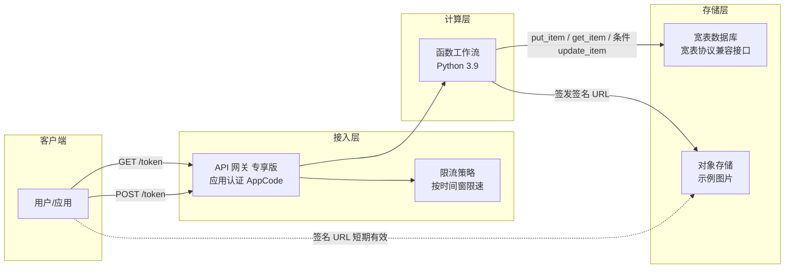

# internet-obs-single-use-token

> **互联网场景下的对象存储单次使用 token 短期签名 URL 交换服务**
[](LICENSE)
[](https://support.huaweicloud.com/intl/en-us/)
[](#)
---

## 1. 简介 / Overview

本实践提供 **单次使用 token + 短期签名 URL 交换** 服务，用于受控访问对象存储桶中的对象。客户端先通过 `GET /token` 申请一次性 token，再用 `POST /token` 换取一个短期（默认 300 秒）的签名 URL；同一 token 只能被消费一次（防重用），通过宽表数据库的条件写实现原子防重。面向 DevOps / 后端 / 安全运维工程师，可作为参考架构 / 学习样例 / 生产模板使用。

### 核心能力

- **单次使用 token 生成**：`GET /token` 生成 URL-safe 随机 token 写入宽表数据库（兼容宽表协议接口）
- **token 换短期签名 URL**：`POST /token` 以条件写原子地把 `valid: true` 改为 `false`（防重用），再签发对象存储短期签名 URL
- **接入层速率限制**：网关限流策略按时间窗约束单 API 请求量
- **应用认证**：客户端在 `X-Apig-AppCode` 头携带共享密钥，网关侧完成鉴权
- **对象存储私有桶 + AES256 加密**：桶级服务端加密；桶为私有且不附加公共策略，对象不暴露匿名读取
- **可选 Web 应用防火墙**：模块随仓库提供，默认关闭（见 [第 5 节](#5-涉及云服务) 说明）

---

---

## 2. 目录

- [1. 简介 / Overview](#1-简介--overview)
- [2. 目录](#2-目录)
- [3. 架构图](#3-架构图)
- [4. 方案亮点](#4-方案亮点)
- [5. 涉及云服务](#5-涉及云服务)
- [6. 前置条件](#6-前置条件)
- [7. 快速开始](#7-快速开始)
- [8. 分步部署](#8-分步部署)
- [9. 使用方法 / 验证](#9-使用方法--验证)
- [10. 清理资源](#10-清理资源)
- [11. 详细说明](#11-详细说明)
- [12. 依赖](#12-依赖)
- [13. FAQ / 故障排除](#13-faq--故障排除)
- [14. 贡献指南](#14-贡献指南)
- [15. 许可证](#15-许可证)
- [16. 联系方式 / 维护者](#16-联系方式--维护者)

---

---

## 3. 架构图

> 单次 token + 短期签名 URL 两步过程：GET 申请 → POST 换 URL → 客户端凭 URL 直取对象



**关键组件说明**：

- **API 网关（专享版）**：托管 API 分组 + 应用认证（AppCode）+ 两条 API（GET/POST `/token`）+ 限流策略
- **函数工作流**：Python 3.9 运行时；`handler.py` 自实现 GET/POST 路由 + 宽表条件写 + 对象存储签名 URL 签发
- **宽表数据库（宽表协议兼容接口）**：集群形态实例；token 表在首次写入时自动创建（键为 `token`，含 TTL 属性）
- **对象存储**：私有桶（不附加公共策略）+ AES256 加密 + 示例图片
- **Web 应用防火墙（可选）**：默认关闭，模块随仓库提供（见 [第 5 节](#5-涉及云服务)）

---

---

## 4. 方案亮点

- **单次使用 token 防重用**：条件写 `ConditionExpression="valid = :true"` 原子保证 token 只被消费一次；并发请求中只有一方成功
- **客户端实现简化**：应用认证（`X-Apig-AppCode` 头）替代请求签名计算，客户端无需实现签名逻辑
- **短期签名 URL**：默认 300 秒有效期，过期自动失效
- **对象存储数据面与函数解耦**：函数只负责签发 URL，真正的对象读取由客户端持 URL 直连对象存储完成
- **Serverless 计算**：函数由平台托管，按事件触发执行
- **Terraform 模块化**：5 个子模块按依赖顺序编排，便于二次开发与单元替换
- **IaC 静态校验通过**：格式检查 / 初始化 / 配置校验三项均零错误

---

---

## 5. 涉及云服务

| 服务 | 用途 | 备注 |
|---|---|---|
| API 网关（APIG） | API 分组 + 应用认证 + API 发布 + 限流策略 | 专享版基础版规格 |
| 函数工作流（FunctionGraph） | 处理 GET/POST `/token` | 运行时 Python 3.9；代码包经对象存储下发 |
| 对象存储服务（OBS） | 示例图片 + 函数代码包 + 签名 URL 目标 | 私有桶；AES256 加密 |
| 云数据库 GeminiDB | token 存储（键为 `token`，含 TTL 属性） | 宽表协议兼容接口；集群形态 |
| Web 应用防火墙（WAF） | 通用 Web 防护 | **模块随仓库提供，默认关闭**；该服务为可选服务 |
| 统一身份认证（IAM） | 函数执行委托（读取对象存储对象） | 全局服务级角色 |
| 虚拟私有云（VPC） | 宽表实例 / 网关 / 函数的网络集成 | 1 个 VPC + 1 个子网 + 1 个安全组 |

> **速率限制落在哪**：接入层限流策略承担速率限制职责；如表层攻击防护有强需求，可把 `enable_waf` 置为 `true`，但需先完成 WAF 服务开通。

---

---

## 6. 前置条件

| 项 | 要求 | 说明 |
|---|---|---|
| **账号** | 已开通华为云账号并完成实名认证 | 个人/企业账号均可 |
| **权限** | 账号具备 IAM **Tenant Administrator** 权限（或覆盖相同资源创建范围的权限组合） | 用于创建 VPC / APIG / FunctionGraph / GeminiDB / OBS 等资源 |
| **Region** | 推荐 `cn-north-4`（北京四） | Terraform 默认值 |
| **Terraform** | `>= 1.5.0` | IaC 部署工具 |
| **huaweicloud Provider** | `~> 1.95` | 华为云 Terraform Provider |
| **PowerShell** | `>= 5.1`（Windows） | 打包函数代码 + 调用部署命令 |
| **访问凭据** | 在华为云「我的凭证」页面获取访问密钥，并以环境变量形式提供给 Terraform | **不要**将凭据写入任何代码或配置文件 |

---

---

## 7. 快速开始

### 一键部署（推荐）

```powershell
# 1. 进入本仓库根目录
cd internet-obs-single-use-token

# 2. 配置华为云访问凭据（环境变量方式，参见第 6 节）
$env:HW_ACCESS_KEY = "<your-access-key>"
$env:HW_SECRET_KEY = "<your-secret-key>"

# 3. 打包函数代码（生成 dist/token-handler.zip）
powershell -ExecutionPolicy Bypass -File scripts\package-function.ps1

# 4. 创建 terraform.tfvars 并填写必填项
Copy-Item infra\terraform.tfvars.example infra\terraform.tfvars
# 编辑 infra\terraform.tfvars：obs_bucket_name / code_bucket_name /
# geminidb_password / apig_appcode

# 5. 部署（代码包由部署过程自动上传到对象存储，无需手工上传）
cd infra
terraform init
terraform plan
terraform apply -auto-approve
```

> **部署耗时**：约 10-15 分钟（宽表实例初始化 + 函数发布 + 网关实例启动）。
> **完整步骤与每步预期输出**：参见 [第 8 节](#8-分步部署)。

---

---

## 8. 分步部署

### 步骤 1：初始化工作目录

```powershell
cd internet-obs-single-use-token/infra
terraform init
```

**预期输出**：`Terraform has been successfully initialized!`

### 步骤 2：预演资源变更

```powershell
terraform plan
```

**预期输出**：`Plan: N to add, 0 to change, 0 to destroy.`

### 步骤 3：执行部署

```powershell
terraform apply -auto-approve
```

**预期输出**：`Apply complete! Resources: N added, 0 changed, 0 destroyed.`

### 步骤 4：记录关键输出

```powershell
terraform output
terraform output -raw apig_appcode     # 敏感值，单独读取
```

**预期输出**：列出 `api_base_url` / `token_endpoint` / `obs_bucket_name` / `geminidb_endpoint` / `function_urn` 等关键字段值，请妥善保存用于后续验证。

---

---

## 9. 使用方法 / 验证

> 以下命令用于**部署后**自验业务功能，请按顺序执行。仓库交付前已完成 IaC 静态校验（格式检查 / 初始化 / 配置校验三项通过）；业务面结果需在真实部署环境取得。

### 验证 1：申请单次使用 token（GET /token）

```powershell
# 替换为 terraform output 的实际值
$baseUrl = "<terraform output -raw api_base_url>"
$appCode = "<terraform output -raw apig_appcode>"

$headers = @{ "X-Apig-AppCode" = $appCode }
$resp = Invoke-RestMethod -Method Get -Uri "$baseUrl/token" -Headers $headers
$resp | ConvertTo-Json -Depth 5

$token = $resp.token
$expiresAt = $resp.expires_at
Write-Host "token=$token expiresAt=$expiresAt"
```

**预期输出**：
```json
{
  "token": "<43 字符 URL-safe 随机串>",
  "expires_at": 1700003600
}
```

### 验证 2：用 token 换短期签名 URL（POST /token）

```powershell
$body = @{ token = $token } | ConvertTo-Json
$resp = Invoke-RestMethod -Method Post -Uri "$baseUrl/token" `
    -Headers $headers -ContentType "application/json" -Body $body
$resp | ConvertTo-Json -Depth 5

$signedUrl = $resp.presigned_url
Write-Host "signedUrl=$signedUrl"
```

**预期输出**：
```json
{
  "presigned_url": "https://<bucket>.obs.cn-north-4.myhuaweicloud.com/sample-image.png?AWSAccessKeyId=...&Expires=...&Signature=..."
}
```

### 验证 3：用签名 URL 取对象

```powershell
Invoke-WebRequest -Uri $signedUrl -OutFile "downloaded-sample-image.png"
Get-Item "downloaded-sample-image.png" | Format-List Name, Length
```

**预期输出**：下载到本地 `downloaded-sample-image.png`（256x256 占位图片）。

### 验证 4：验证单次使用（同一 token 再用应被拒）

```powershell
$body = @{ token = $token } | ConvertTo-Json
try {
    $resp = Invoke-RestMethod -Method Post -Uri "$baseUrl/token" `
        -Headers $headers -ContentType "application/json" -Body $body
    Write-Host "UNEXPECTED: token reused OK -> $($resp | ConvertTo-Json -Depth 5)"
} catch {
    $statusCode = $_.Exception.Response.StatusCode.value__
    Write-Host "statusCode=$statusCode"
}
```

**预期输出**：
```
statusCode=403
```

### 验证 5：限流生效

```powershell
# 在限流时间窗内高频调用，应出现 429
1..200 | ForEach-Object {
    try {
        Invoke-RestMethod -Method Get -Uri "$baseUrl/token" -Headers $headers | Out-Null
    } catch {
        Write-Host "request #$_ -> $($_.Exception.Response.StatusCode.value__)"
    }
}
```

**预期输出**：窗口内超出上限的请求返回 `429`。

部署完成后请按本节步骤自行验证，确认业务功能可用，方可视为交付完成。

---

---

## 10. 清理资源

```powershell
cd internet-obs-single-use-token/infra
terraform destroy -auto-approve
```

**预期输出**：`Destroy complete! Resources: N destroyed.`

> **避免资源残留**：
> - `terraform destroy` 仅释放 Terraform 状态中追踪的资源；
> - 函数代码包对象由模块托管时会一并删除；若手工上传到桶根，需自行清理；
> - 账号内其他任务共享的 VPC / 子网等资源不受影响。

---

---

## 11. 详细说明

### 工作流程

1. **客户端调用 GET /token**：网关完成应用认证 → 函数生成 URL-safe 随机 token → 数据模型校验 → 写入宽表（`valid=true`，`ttl=created_at+3600`）→ 返回 `token` + `expires_at`
2. **客户端调用 POST /token**：网关完成应用认证 + 入参校验（`token` 长度 32-100，字符集 `[A-Za-z0-9_-]`）→ 函数查询条目 → 校验 `valid=true` → **条件写**把 `valid` 由 `true` 置 `false`（条件失败即并发重用）→ 签发 300 秒签名 URL → 返回 URL
3. **客户端凭签名 URL 直取对象**：对象存储校验签名与有效期 → 返回对象字节

### 配置项

| 变量 | 默认值 | 说明 |
|---|---|---|
| `region` | `cn-north-4` | 华为云 Region |
| `project_name` | `internet-obs-single-use-token` | 项目名（资源命名前缀） |
| `obs_bucket_name` | （必填） | 对象存储桶名（全局唯一） |
| `code_bucket_name` | （必填） | 存放函数代码包的桶名（可与上一个相同） |
| `geminidb_password` | （必填） | 宽表实例管理员密码（建议用 `TF_VAR_geminidb_password` 注入） |
| `apig_appcode` | （必填） | 应用认证 AppCode（建议用 `TF_VAR_apig_appcode` 注入） |
| `token_table_name` | `single-use-tokens` | token 表名 |
| `geminidb_flavor_spec` | `geminidb.cassandra.large.4` | 宽表实例节点规格 |
| `geminidb_availability_zone` | `cn-north-4a,cn-north-4b,cn-north-4c` | 可用区（逗号分隔） |
| `geminidb_node_num` | `3` | 节点数（集群形态 3–12） |
| `geminidb_storage_size` | `100` | 单节点磁盘容量（GB） |
| `token_ttl_seconds` | `3600` | token 有效期（秒） |
| `presigned_url_expiration` | `300` | 签名 URL 有效期（秒） |
| `function_memory_size` | `512` | 函数内存（MB） |
| `function_timeout` | `30` | 函数超时（秒） |
| `apig_max_api_requests` | `100` | 限流策略：时间窗内单 API 最大请求数 |
| `apig_throttle_period` / `apig_throttle_period_unit` | `1` / `MINUTE` | 限流时间窗 |
| `enable_waf` | `false` | 是否启用可选防火墙模块 |
| `waf_domain_name` | `""` | 接入防火墙的域名（启用时必填） |

### 接口 / API

| 接口 | 方法 | 鉴权 | 说明 |
|---|---|---|---|
| `/token` | GET | `X-Apig-AppCode` | 生成单次使用 token，返回 `{token, expires_at}` |
| `/token` | POST | `X-Apig-AppCode` | 用 token 换短期签名 URL，返回 `{presigned_url}` |

详见 `docs/architecture.md`。

---

---

## 12. 依赖

| 名称 | 版本 | 用途 |
|---|---|---|
| Terraform | `>= 1.5.0` | IaC 编排 |
| huaweicloud Provider | `~> 1.95` | 华为云资源 |
| Python（函数运行时） | `3.9` | 函数执行环境 |
| boto3 | `1.35.99` | 宽表协议兼容接口客户端 |
| pydantic | `2.10.4` | 请求/响应与条目结构校验 |
| esdk-obs-python | 运行环境内置 | 对象存储签名 URL 签发 |

> 对象存储客户端由函数运行环境内置，**不随代码包携带**；宽表协议客户端与 pydantic 需随包携带（打包脚本已处理）。

---

---

## 13. FAQ / 故障排除

### Q1：部署时提示「权限不足」怎么办？

**A**：确认账号具备 IAM **Tenant Administrator** 权限，或至少包含 `VPC Administrator`、`FunctionGraph Administrator`、`APIG Administrator`、`GeminiDB FullAccess`、`OBS Administrator` 等子服务管理员权限。

### Q2：网关部署后无法访问怎么办？

**A**：检查 4 项：
1. 网关实例是否创建成功（`terraform output apig_instance_id`）
2. AppCode 是否正确（控制台「API 网关 → 应用管理」查看）
3. 客户端是否在 `X-Apig-AppCode` 头携带 AppCode
4. 是否被限流（返回 429 说明触发了限流策略）

### Q3：函数运行报错怎么办？

**A**：进入控制台「函数工作流 → 函数列表 → token-handler → 日志」查看。常见错误：
- 连接宽表失败 → 检查 `GEMINIDB_ENDPOINT` 与 `GEMINIDB_PORT`（集群形态端口为 **80**）
- 鉴权失败 → 确认 `GEMINIDB_USER` 为实例账号 `rwuser`、`GEMINIDB_PASSWORD` 为实例管理员密码
- 签名 URL 签发失败 → 确认函数执行委托已授予对象存储全局服务级角色，且桶策略已放通委托读取

### Q4：签名 URL 取对象失败怎么办？

**A**：检查 3 项：
1. URL 是否过期（默认 300 秒）
2. 桶名与对象键是否正确
3. 桶策略是否放通了签名主体对该对象的读取权限

### 故障排查清单

| 现象 | 可能原因 | 排查方法 |
|---|---|---|
| `terraform apply` 失败 | 权限不足 / Region 不支持该规格 / 桶名已存在 | 查看错误码；按 [Q1](#q1部署时提示权限不足怎么办) 处理 |
| GET /token 返回 500 | 宽表连接失败 / 委托权限不足 | 查看函数日志 |
| POST /token 返回 500 | 条件写失败 / 签名 URL 签发失败 | 查看函数日志 |
| POST /token 返回 403 | token 不存在 / 已过期 / 已被使用 | 申请新 token 重试 |
| 请求返回 429 | 触发限流策略 | 调整 `apig_max_api_requests` 或降低调用频率 |

---

---

## 14. 贡献指南

欢迎提交 Issue 与 PR。请遵循以下流程：

1. **Issue**：描述问题 / 建议（含复现命令、预期 / 实际输出）
2. **PR**：基于 `main` 分支新建 feature 分支；提交前运行 `terraform fmt -check` 与 `terraform validate`
3. **Code Review**：由维护者审核通过后合并

---

---

## 15. 许可证

本实践采用 **MIT No Attribution** 许可证发布。详见仓库根目录 [`LICENSE`](LICENSE) 文件。

```
MIT No Attribution

Copyright (c) Huawei Cloud

Permission is hereby granted, free of charge, to any person obtaining a copy
of this software... (without attribution required)
```

---

---

## 16. 联系方式 / 维护者
| 项 | 内容 |
|---|---|
| **创建者** | [dgc-git](https://github.com/dgc-git) |
| **维护者** | [dgc-git](https://github.com/dgc-git) |
| **联系方式** | GitHub Issues / PR（见[第 14 节](#14-贡献指南)） |
